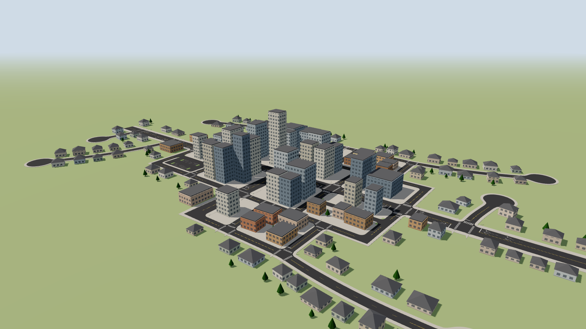
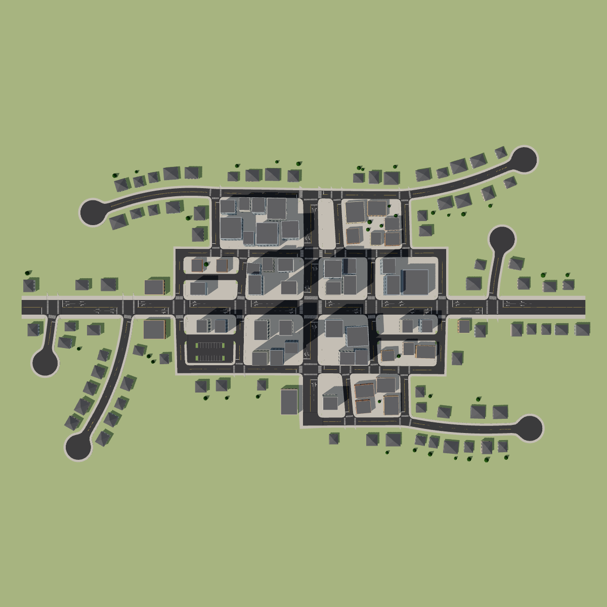
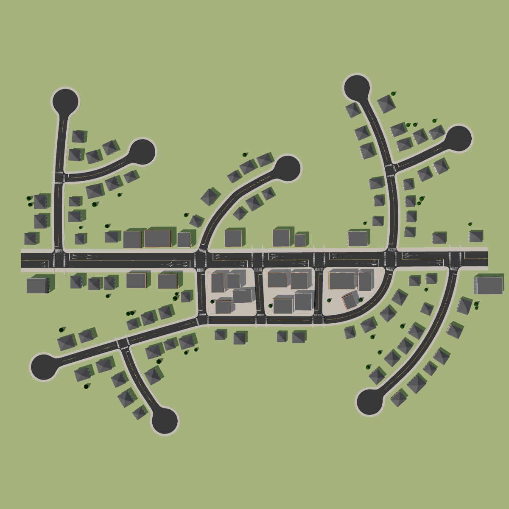
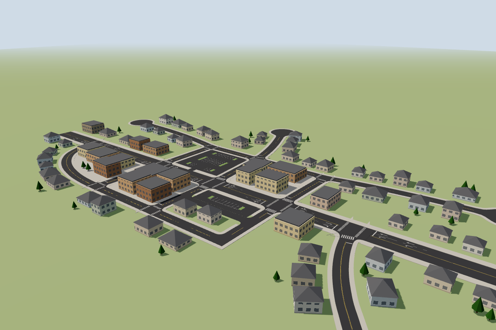
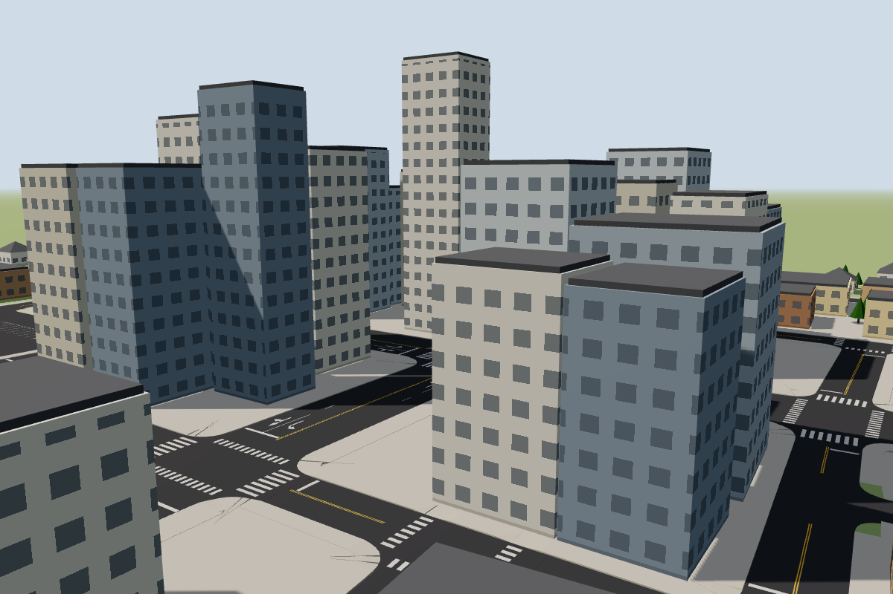
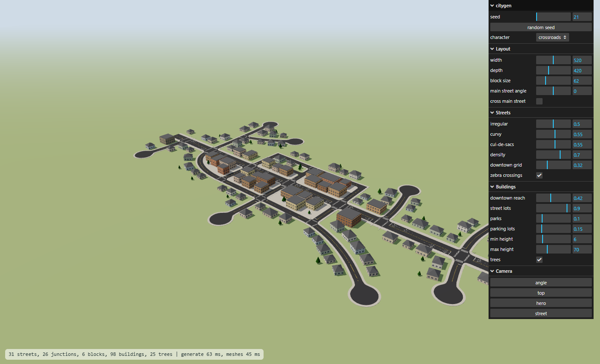

<h1 align="center">citygen</h1>

<p align="center"><b>Procedural towns and cities for three.js: street networks, blocks, lots, sidewalks, lane markings and buildings, from a single seed.</b></p>

<p align="center"></p>

<table>
  <tr>
    <td></td>
    <td></td>
  </tr>
  <tr>
    <td></td>
    <td></td>
  </tr>
</table>

## Features

- **Street plans with character.** Five town types (`city`, `crossroads`, `hill`, `river`, `village`) grow the way small towns do: a main street, a downtown grid with uneven spacing and slight angles, back streets and alleys, then curving collectors, loops, crescents and cul-de-sacs with round turnarounds.
- **Real road geometry.** Every road is laid to a cross-section profile (lanes, widths, sidewalks, parking bays, medians). Junctions are trimmed and filled with one polygon whose kerbs are filleted round each corner; sidewalks follow the curves.
- **Markings.** Centre lines (dashed or double where passing is unsafe), edge lines, lane lines, turn lanes with arrows, stop bars and zebra crossings with dropped kerbs.
- **Blocks and districts.** The faces of the street network become city blocks, zoned into downtown, shops, suburb, industrial, park or parking lot, by distance from the middle and whether they front the main street.
- **Buildings on lots.** Each building faces the street it stands on, at whatever angle the street runs, kept clear of roads and of each other. Streets no block closes round (dead ends, cul-de-sacs, the town's edge) get lots along them too.
- **No assets.** Everything is procedural geometry. Buildings are instanced boxes with a window shader; swap in your own models in a few lines.
- **Deterministic and fast.** Same settings, same town. A full city generates and meshes in well under 100 ms each.

## Quick start

```bash
git clone <this repo> citygen
cd citygen
bun install        # or: npm install
bun run dev        # or: npm run dev    -> http://localhost:5199
```

The demo has a panel for every setting below, camera presets, and takes the settings as URL parameters too (`?seed=12&character=village&view=top`, add `&shot` to hide the panel).

<p align="center"></p>

## Usage

The library is plain TypeScript source (no build step). Copy `src/` into your project or import it directly; `three` is the only dependency.

```ts
import * as THREE from "three";
import { generateCity, buildCityMeshes } from "./citygen/src";

const city = generateCity({ seed: 7, character: "city", width: 560, depth: 460 });
scene.add(buildCityMeshes(city));

// The data is all there if you want to do your own thing with it:
city.layout.roads;     // every road: centre-line samples, half width, sidewalks, profile
city.layout.junctions; // every junction: outline polygon, arms, kerb corners
city.blocks;           // { shape: { outline, area, centre }, district, parking? }
city.buildings;        // { id, kind, district, x, y, z, yaw, width, depth, height }
city.trees;            // { x, y, z, scale }
```

`buildCityMeshes` is a thin layer over separate builders you can use on their own: `buildRoadMeshes`, `buildBuildingMeshes`, `buildTreeMeshes`, `buildGround`. Pass `{ palette: { asphalt: "#333", ... } }` to recolour, or `{ shadows: false }`.

## Settings

| Setting | Default | What it does |
| --- | --- | --- |
| `seed` | `1` | Seeds the street plan and everything built on it. |
| `character` | `"city"` | `city`, `crossroads`, `hill`, `river` or `village`: the street pattern and the default knobs below. |
| `width`, `depth` | `520`, `420` | The area the streets are laid in, metres along and across the main street. |
| `angle` | `0` | The main street's direction, radians. |
| `block` | `62` | About how far apart side streets are along the main street, metres. |
| `irregular` | `0.5` | 0..1: how much downtown streets wander off square and back streets bend. |
| `curvy` | by character | 0..1: how much residential streets bend and wander. |
| `culdesacs` | by character | 0..1: how many residential streets end in a cul-de-sac rather than loop back. |
| `density` | by character | 0..1: how much of the area round downtown gets streets. |
| `core` | by character | 0..1: how big the downtown grid is. |
| `crossStreet` | city only | A second main street across the first. |
| `exits` | none | Directions (radians) of roads out of town: the main street runs out along them. |
| `downtown` | `0.42` | How far out from the middle (share of the half size) downtown towers reach. |
| `lots` | `0.9` | Share of each street side outside the blocks that gets a lot. |
| `parks` | `0.1` | Share of residential blocks that become parks. |
| `parking` | `0.15` | Chance a small shops or industrial block is a parking lot. |
| `minHeight`, `maxHeight` | `6`, `70` | Building heights, metres. Downtown rises toward the middle into a skyline. |
| `crossings` | `true` | Zebra crossings at junctions of three or more streets. |
| `trees` | `true` | Trees in parks and back yards. |
| `kit` | box kit | The buildings to place (see below). |

The per-character knob defaults are exported as `TOWN_CHARACTER_KNOBS`.

## How it works

1. **Street plan** (`core/town-plan.ts`). A main street through the middle, side streets off it at uneven spacing, back streets and alleys, then residential streets grown outward as loops and cul-de-sacs, each one kept clear of the others so there is room for a lot on each side. The plan is just nodes and streets between them.
2. **Network layout** (`core/network.ts`, `roads.ts`, `road-sections.ts`, `lanes.ts`). Each street gets a cross-section profile by class (main, local, lane) and is sampled along a filleted centre line. At every node the roads are trimmed back and the junction is closed with one polygon, its kerbs filleted round each corner; sidewalks run round the corners, zebras cross where profiles ask for them, turn lanes open up approaching busy junctions.
3. **Blocks** (`core/blocks.ts`). Walking the network keeping the ground on your left traces every face; pushed in by each road's half width and sidewalk, a face is exactly the ground behind the kerbs. Each block gets a district.
4. **Lots and buildings** (`blocks.ts`, `frontage.ts`). Along every side of a block, buildings from the district's pool are placed facing the street, set back and spaced by district; downtown and industry fill the interior too. Streets outside any block get houses along both sides.
5. **Meshes** (`mesh/roads-geometry.ts`, `mesh/city-meshes.ts`). The network is turned into merged triangle soups per surface (asphalt, paint, sidewalk, lawn, concrete); buildings and trees become instanced meshes.

The core (`src/core`) is three-free and pure data; only `src/mesh` touches three.js.

## Bring your own models

The generator only knows a building by its footprint and height. A `TownKit` is a list of them:

```ts
import { generateCity, type TownKit } from "./citygen/src";

const kit: TownKit = {
  buildings: [
    { id: "cottage", kind: "house", size: [9, 10], height: 6 },
    { id: "corner-shop", kind: "shop", size: [14, 12], height: 8 },
    { id: "office-a", kind: "tower", size: [20, 20], height: 45, districts: ["downtown"] },
    // ...
  ],
};
const city = generateCity({ seed: 3, kit });
```

`size` is `[width along the street, depth back from it]` in metres. By default a `house` goes in suburbs, a `tower` 15 m or taller downtown, a low wide building in industry and shops; set `districts` to override.

Then draw each placed building with your model instead of a box. A building's origin is the centre of its footprint on the ground, and its front (local +Z) faces the street:

```ts
for (const b of city.buildings) {
  const model = myModels[b.id].clone(); // authored with its footprint centred on the origin, front facing +Z
  model.position.set(b.x, b.y, b.z);
  model.rotation.y = b.yaw;
  scene.add(model);
}
```

For many copies, group by `b.id` and use one `InstancedMesh` per model. `b.height` is jittered per building (and stretched downtown); ignore it if your models have fixed heights.

## Tests and screenshots

```bash
bun test               # a few sanity checks
bun run typecheck
bun run screenshots    # regenerates docs/*.png headless (needs: bunx playwright install chromium)
```

## Status

Extracted from a personal game engine and provided as-is. It is a one-time export and is **not maintained**: issues and pull requests will probably go unanswered. Fork it and make it yours.

Some code paths from the original remain that a flat, town-only world never reaches (graded roads on hills, raised verges, bridges, roadside guard rails, painted and grass medians on wider profiles). They work, but are lightly exercised here.

## License

[MIT](LICENSE)
